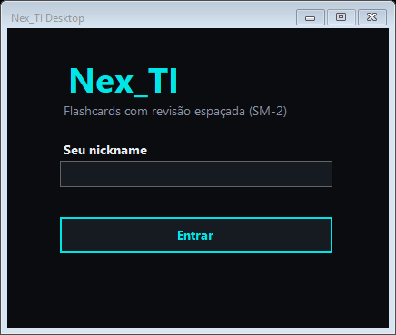
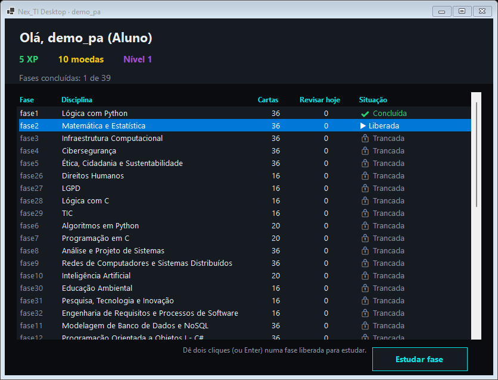
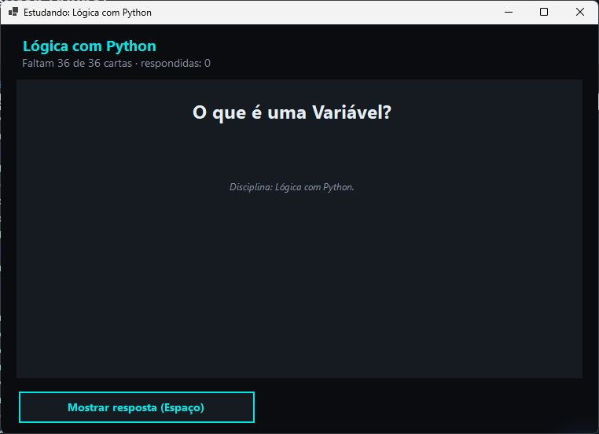
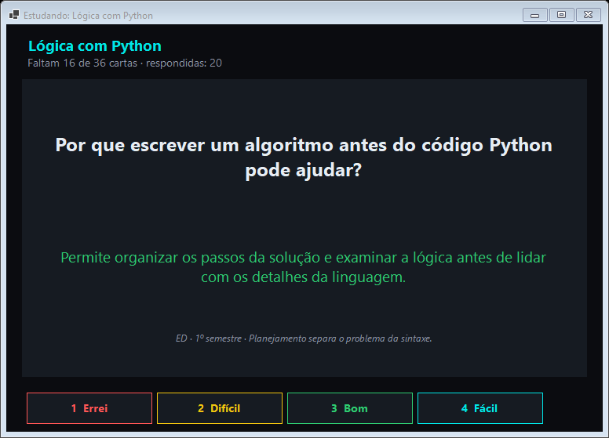
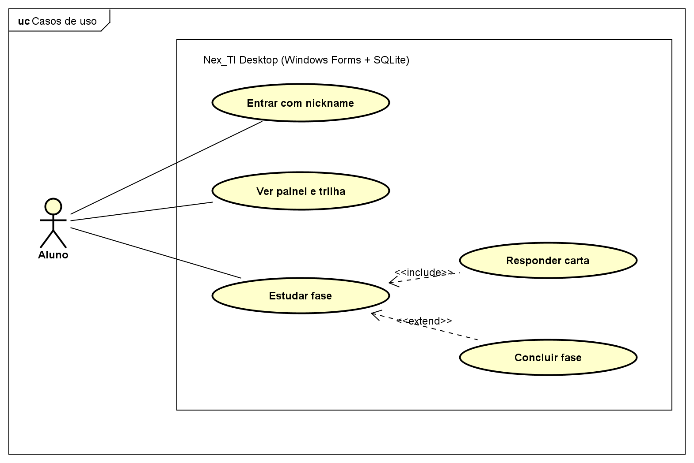
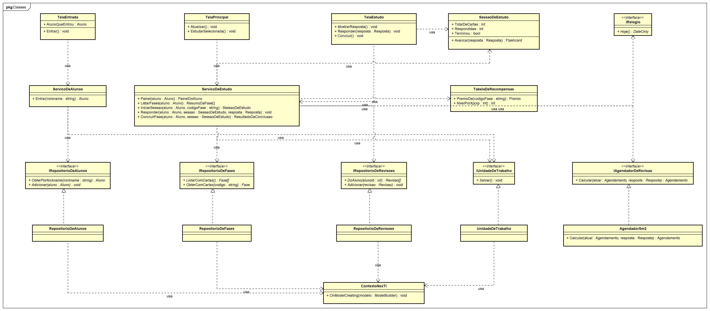
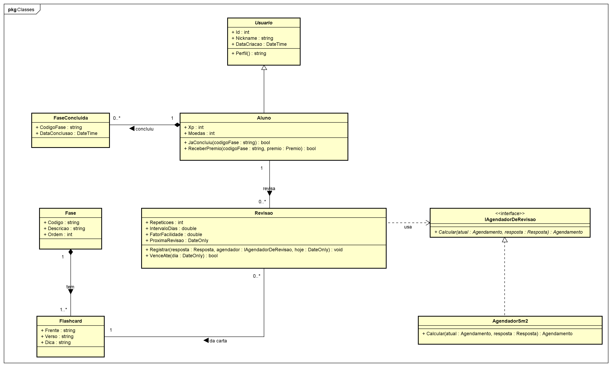
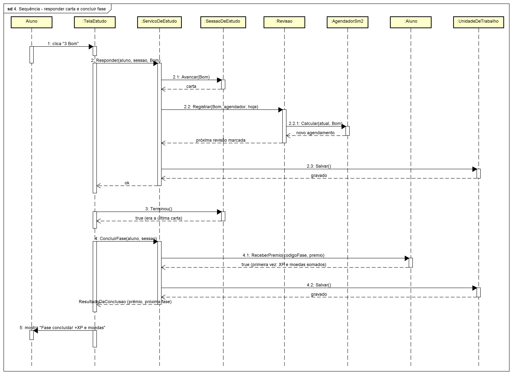
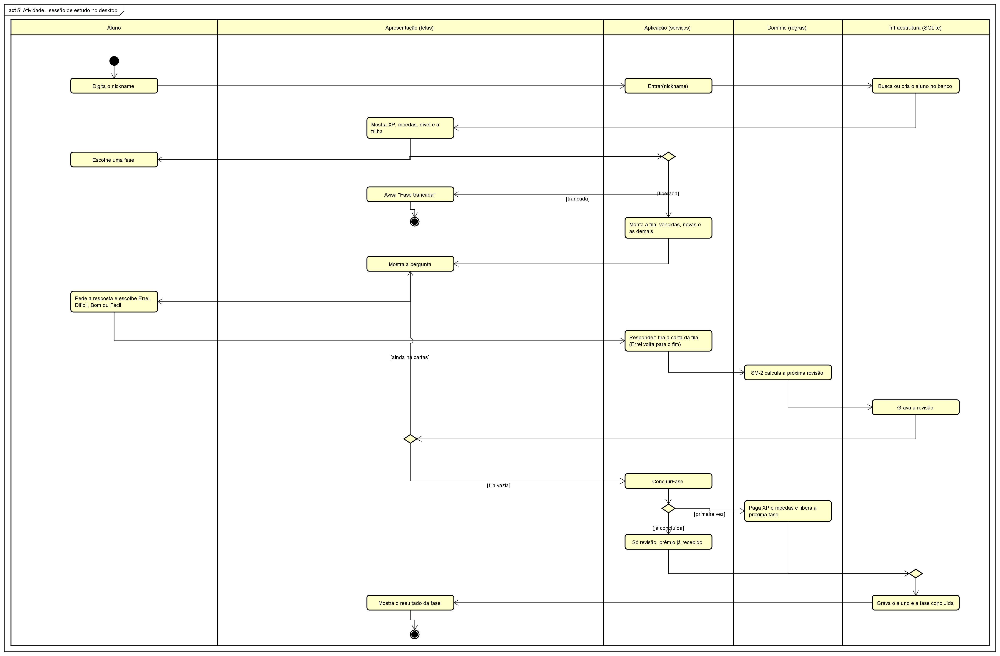

# Nex_TI Desktop

Versão **desktop** do Nex_TI em escala pequena, feita para a atividade *9 – Apresentação em grupo
da disciplina P.A. em .NET* (apresentação em 27/10/2026). Ela mostra como construir uma
aplicação desktop organizada, com **orientação a objetos**, **arquitetura em camadas**,
**modularização** e os **quatro diagramas UML** pedidos: caso de uso, classe, sequência e atividade.

O programa faz o centro do Nex_TI: o aluno entra com um nickname, vê a trilha de 25 fases,
estuda as cartas com o **SM-2** e ganha **XP e moedas** ao concluir cada fase (só na primeira vez).
As cartas e os prêmios são os mesmos do site, do app e da API.

| Entrada | Painel e trilha |
|---|---|
|  |  |
| **Pergunta** | **Resposta e os botões do SM-2** |
|  |  |

## Como rodar

Precisa do **.NET 10 SDK** no Windows (o programa usa Windows Forms).

```powershell
cd sistema/apps/desktop
dotnet run --project src/NexTI.Desktop.Apresentacao     # abre o programa
dotnet test                                            # roda os 27 testes
```

Na primeira vez, o programa cria o banco SQLite em `%LOCALAPPDATA%\NexTI.Desktop\nexti-desktop.db`,
aplica a migration e coloca as fases e as cartas. Não precisa de internet nem da API.

**Atalhos no estudo:** Espaço mostra a resposta; 1, 2, 3 e 4 respondem Errei, Difícil, Bom e Fácil;
Esc fecha a fase.

## Como abrir cada parte no Antigravity

Para a apresentação de 27/10, tudo abre de dentro do Antigravity (vale igual para o VS Code).

**1. Abrir o projeto:** *File → Open Folder* e escolha a pasta `PIM_IV` inteira (a raiz do
repositório, não só esta pasta). Assim os atalhos abaixo funcionam.

**2. Atalhos prontos:** `Ctrl+Shift+P` → digite **Tasks: Run Task** → escolha:

| Tarefa | O que faz |
|---|---|
| Desktop: abrir o programa | Compila e abre o Nex_TI Desktop (a primeira vez leva uns 20 segundos) |
| Desktop: rodar os testes | Roda os 27 testes no terminal |
| Apresentação: abrir os slides (PDF) | Abre o PDF dos slides no leitor de PDF do Windows |
| Apresentação: abrir os diagramas do desktop no Astah | Abre o `.asta` no Astah |
| Apresentação: abrir o GitHub | Abre o repositório no navegador |
| Desktop: começar do zero | Apaga o banco local do programa, para mostrar como se fosse a primeira vez |
| Sistema: subir a API e o site | O Nex_TI web: API na porta 5000 e site na 5501 |

**3. Sem os atalhos, pelo terminal** (*Terminal → New Terminal*, ou `` Ctrl+` ``):

```powershell
cd sistema/apps/desktop
dotnet run --project src/NexTI.Desktop.Apresentacao   # abre o programa
dotnet test                                          # roda os testes
Start-Process "docs/apresentacao/Nex_TI - Apresentacao PA DotNet.pdf"   # abre os slides
```

**4. Onde está cada coisa** (`Ctrl+P` e digite o nome do arquivo para abrir direto):

| O quê | Arquivo ou pasta | Como mostrar |
|---|---|---|
| Slides e roteiro | `docs/apresentacao/` | O PDF pela tarefa acima. O roteiro (`ROTEIRO_DO_PALESTRANTE.md`) fica mais legível com `Ctrl+Shift+V` |
| Este guia, com fotos e diagramas | `README.md` (este arquivo) | `Ctrl+Shift+V` abre a visualização com as imagens |
| Os quatro diagramas | `docs/diagramas/` | Clique no `.png`: abre como imagem no editor |
| Arquivo do Astah | `docs/diagramas/Diagrams Nex_TI Desktop - PA DotNet.asta` | Pela tarefa, ou com dois cliques no Explorer do Windows |
| Herança e classe abstrata | `Usuario.cs` e `Aluno.cs` | `Ctrl+P` → `Aluno.cs` |
| Encapsulamento (prêmio uma vez só) | `Aluno.cs`, método `ReceberPremio` | `Ctrl+P` → `Aluno.cs` |
| Interface e SM-2 | `Regras.cs` (`IAgendadorDeRevisao`) e `AgendadorSm2.cs` | `Ctrl+P` → `AgendadorSm2.cs` |
| Casos de uso (camada de Aplicação) | `ServicoDeEstudo.cs` | `Ctrl+P` → `ServicoDeEstudo.cs` |
| Banco (EF Core + SQLite) | `ContextoNexTI.cs` e a pasta `Dados/Migrations` | `Ctrl+P` → `ContextoNexTI.cs` |
| Onde as camadas se ligam | `src/NexTI.Desktop.Apresentacao/Program.cs` | `Ctrl+P` → `Program.cs` (escolha o do desktop) |
| As telas | `src/NexTI.Desktop.Apresentacao/Telas/` | `TelaEstudo.cs` mostra os quatro botões do SM-2 |
| Testes | `tests/NexTI.Desktop.Testes/` | `CasosDeUsoTestes.cs` testa o programa de ponta a ponta |

O Antigravity pode sugerir instalar extensões de C#; não precisa, porque o programa e os testes
rodam pelo terminal.

## Módulos: um projeto por camada

```text
desktop/
├── NexTI.Desktop.slnx
├── src/
│   ├── NexTI.Desktop.Apresentacao/    Windows Forms: as telas e o Program.cs (liga as camadas)
│   ├── NexTI.Desktop.Aplicacao/       Casos de uso: ServicoDeAlunos, ServicoDeEstudo, SessaoDeEstudo
│   ├── NexTI.Desktop.Dominio/         Entidades, regra do SM-2 e interfaces dos repositórios
│   └── NexTI.Desktop.Infraestrutura/  EF Core + SQLite: DbContext, migration, repositórios e semente
├── tests/NexTI.Desktop.Testes/        xUnit: regras, domínio e casos de uso de ponta a ponta
└── docs/
    ├── apresentacao/                  Slides (HTML e PDF) e roteiro da apresentação de 27/10
    ├── diagramas/                     O .asta do Astah, as imagens exportadas e as cópias usadas aqui
    └── telas/                         Fotos das telas do programa
```

Cada camada é um projeto `.csproj` separado, e as referências só apontam para baixo:

```text
Apresentação ──► Aplicação ──► Domínio ◄── Infraestrutura
      └──────────────────────────────────────┘ (só o Program.cs, para montar os objetos)
```

O **Domínio não depende de ninguém**. A Aplicação usa só as interfaces do Domínio
(`IRepositorioDeFases`, `IUnidadeDeTrabalho`…), sem saber que por baixo existe EF Core ou SQLite.
Quem implementa essas interfaces é a Infraestrutura. O `Program.cs` é o único lugar que conhece
todas as camadas: ele abre o banco, monta os serviços e abre as telas.

## Onde está cada conceito de orientação a objetos

| Conceito | No código |
|---|---|
| **Classe abstrata** | `Entidade` (base com o `Id`) e `Usuario` (ninguém é "só usuário") |
| **Herança** | `Aluno : Usuario`, e as entidades herdam de `Entidade` |
| **Polimorfismo** | `Usuario.Perfil` é abstrata; o `Aluno` responde "Aluno" |
| **Encapsulamento** | `Aluno.Xp` e `Aluno.Moedas` têm `private set`: só mudam por `ReceberPremio`, que paga uma vez por fase. O construtor de `Usuario` recusa nickname fora de 3 a 20 letras |
| **Interfaces** | `IAgendadorDeRevisao` (o SM-2 pode ser trocado), os repositórios e o `IRelogio` |
| **Composição** | o `Aluno` é dono das `FaseConcluida`; a `Fase`, das `Flashcard` |
| **Injeção de dependência** | os serviços recebem as interfaces pelo construtor; nos testes entram um banco em memória e um relógio falso |

## Banco de dados (EF Core + SQLite)

Segue o caminho do livro-texto da disciplina (PERES, 2026, Unidade II), que no exemplo PetMatch
usa EF Core com SQLite:

- **Modelagem e DbContext:** `Infraestrutura/Dados/ContextoNexTI.cs`. Chaves, índices únicos
  (um prêmio por fase, uma revisão por carta) e a herança `Usuario`/`Aluno` numa tabela só,
  com a coluna `TipoDeUsuario`.
- **Migration:** `Dados/Migrations/…_Inicial.cs`, criada com `dotnet ef migrations add Inicial`.
  O programa aplica as migrations pendentes ao abrir (`Database.Migrate()`).
- **Seed:** `SemeadorDeConteudo` lê o mesmo `conteudo.json` da API (`apps/api/Data/Seed`).
- **Unidade de trabalho:** `UnidadeDeTrabalho.Salvar()` grava de uma vez o aluno, as revisões e as
  fases concluídas.

## Os quatro diagramas UML

Feitos no Astah, pelo gerador `modelagem-uml/02_Modelagem_UML/gerador-astah/GerarDiagramasDesktop.java`
(arquivo `docs/diagramas/Diagrams Nex_TI Desktop - PA DotNet.asta`), com a explicação de cada elemento no campo
*Definition*. As imagens abaixo são cópias das exportadas pelo Astah.

**1. Casos de uso:** o que o aluno faz no programa.



**2. Classes, camadas:** telas → serviços → interfaces do domínio ← implementações com EF Core.



**3. Classes, domínio:** herança, composição, associações com multiplicidade e a interface do SM-2.



**4. Sequência:** o aluno responde a última carta e conclui a fase.



**5. Atividade:** a sessão de estudo inteira, com uma raia para o aluno e uma para cada camada.



## Testes

`dotnet test` roda **27 testes** (xUnit):

- **Mesmas regras do resto do Nex_TI:** o SM-2 e os prêmios passam pelos mesmos casos que o site,
  o app e a API conferem (`packages/shared/tests/sm2-casos.json` e `recompensa-casos.json`).
- **Domínio:** nickname inválido é recusado, o prêmio sai uma vez só e a carta com "Errei" volta
  para o fim da fila.
- **Casos de uso de ponta a ponta**, passando por todas as camadas de verdade (SQLite em memória
  com a migration e o conteúdo reais): só a fase 1 começa liberada, concluir paga uma vez e libera
  a próxima, os dados continuam lá depois de "reabrir o programa" e as cartas vencidas vêm primeiro.

## Referência

PERES, Tarcísio de Souza. *Desenvolvimento web com .NET*. São Paulo: Editora Sol, 2026.
